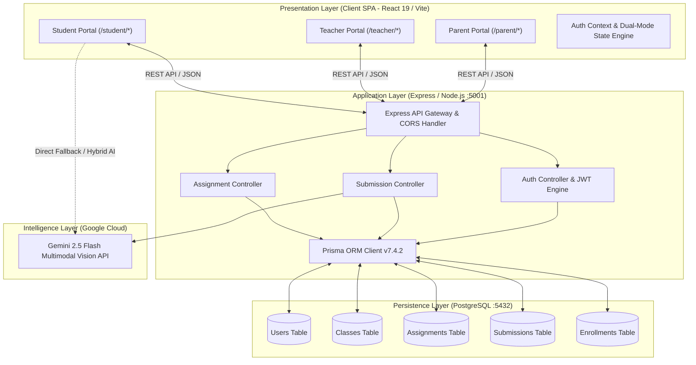
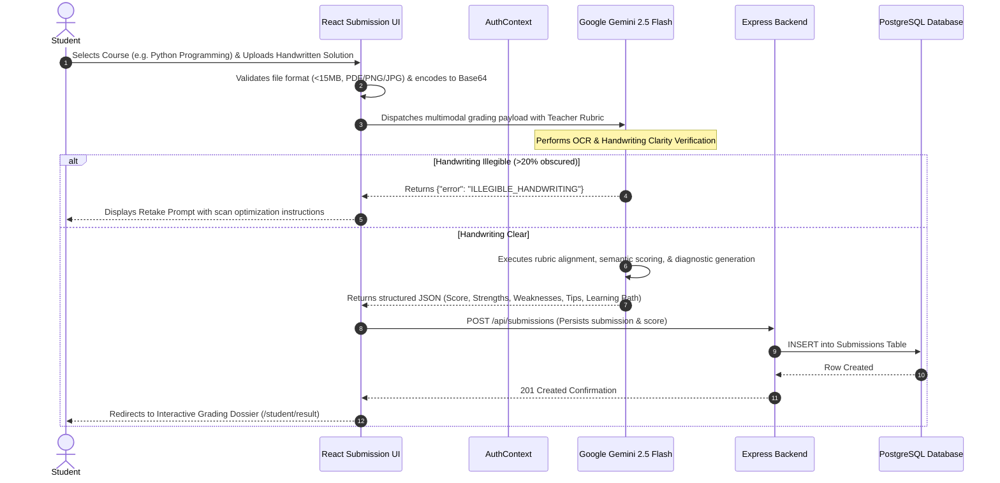
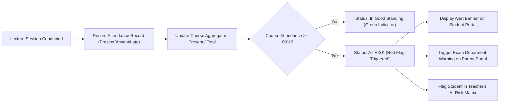

# SmartGrade AI — Software Engineering Project Specification & Architectural Dossier

**Course:** Software Engineering (CS / IT)  
**Project Title:** SmartGrade AI — Multimodal AI-Assisted Assessment, Formative Feedback & Academic Retention Platform  
**Target Domain:** Higher Education & Engineering Colleges (Aligned with UN SDG 4: Quality Education)  
**Version:** 2.0.0-PROD  
**Document Type:** Software Requirements Specification (SRS) & System Architecture Document (SAD)

---

## 1. Executive Summary & Problem Formulation

### 1.1 The Academic Problem
In contemporary engineering and higher education institutions:
1. **Grading Latency & Subjectivity:** Faculty spend 15–20 hours weekly hand-grading subjective assignments and lab scripts. Feedback delays (often 2–3 weeks) severely decouple assessment from the student's learning moment.
2. **Absence of Actionable Diagnostics:** Standard grading yields numerical scores (e.g., 7/10) without identifying root knowledge gaps, specific misconceptions, or targeted remediation pathways.
3. **Decoupled Stakeholder Ecosystem:** Parents, academic advisors, and mentors remain disconnected from real-time performance until end-of-semester exam results, preventing proactive retention interventions.
4. **Attendance Mandate Governance:** Colleges enforce strict attendance requirements (e.g., **80% mandatory attendance** for end-semester exam eligibility). Manual register tracking fails to alert students and parents before the cutoff is irretrievably breached.

### 1.2 The SmartGrade AI Solution
SmartGrade AI is a full-stack, enterprise-grade educational intelligence platform engineered with a **3-Tier decoupled architecture**. It integrates **Google Gemini 2.5 Flash** multimodal vision models to automate handwriting/text assessment, generate pedagogical feedback mapped to teacher rubrics, track lecture-wise attendance against institutional thresholds, and provide role-specific dashboards for **Students**, **Teachers**, and **Parents**.

---

## 2. Software Requirements Specification (SRS) — IEEE 830 Standard

### 2.1 User Personas & Role Matrix
| Role | Primary Responsibilities | Core Value Proposition |
| :--- | :--- | :--- |
| **Student (B.Tech CS)** | Submits digital/handwritten coursework, inspects diagnostic feedback, tracks attendance against the 80% threshold, views gamified badges. | Instant (<60s) remediation feedback, transparent academic standing. |
| **Teacher / Professor** | Creates assignments with custom grading rubrics, monitors batch analytics, detects at-risk students, exports performance reports. | 80% reduction in evaluation toil, algorithmic identification of struggling students. |
| **Parent / Guardian** | Monitors ward's course-wise attendance, inspects teacher remarks, tracks overall grade trajectory, communicates with faculty. | Transparent oversight and early warning before exam debarment. |

### 2.2 Functional Requirements (FR)
- **FR-01 (Authentication & RBAC):** The system shall enforce role-based access control (Student, Teacher, Parent) with JWT session integrity and seamless offline demonstration fallback.
- **FR-02 (Multimodal Submission Ingestion):** The platform shall accept Markdown text answers or scanned handwritten papers (JPG, PNG, PDF up to 15MB).
- **FR-03 (Vision & OCR Verification):** The AI engine shall inspect image clarity. Submissions failing legibility standards (>20% illegible) shall halt evaluation with an explicit `ILLEGIBLE_HANDWRITING` error.
- **FR-04 (Rubric-Anchored AI Evaluation):** When teacher context/rubric is present, Gemini AI shall grade strictly against specified technical criteria (e.g., Leibniz/Lagrange notation, time complexity).
- **FR-05 (Structured Diagnostic Output):** The AI engine shall return strict structured JSON consisting of: score, letter grade, percentage, 3 strengths, 3 weaknesses, actionable tips, knowledge gaps, and step-by-step learning path.
- **FR-06 (Lecture-Wise Attendance Accounting):** The system shall record attendance on a per-course, per-session (Lecture vs. Lab) basis.
- **FR-07 (80% Debarment Guardrail):** The attendance module shall calculate real-time percentage per course and overall semester. Any student dropping below 80% shall trigger a system-wide high-priority alert.
- **FR-08 (Class Analytics & At-Risk Classification):** The teacher portal shall classify students as "At Risk" based on composite metrics (Score <60% or Attendance <80%).
- **FR-09 (Parent Notification & Communication):** The parent portal shall surface critical academic drops and provide direct messaging channels to course instructors.
- **FR-10 (Multilingual Accessibility):** The platform shall support feedback delivery across major regional Indian languages (Hindi, Marathi, Tamil, Telugu, Bengali) to promote inclusive education.

### 2.3 Non-Functional Requirements (NFR)
- **NFR-01 (Performance & Latency):** AI grading pipeline end-to-end execution latency shall not exceed 10 seconds under standard broadband conditions.
- **NFR-02 (High Availability & Resilience):** Client applications shall implement dual-mode resilience (automatic graceful degradation to local demo data store if the PostgreSQL backend is offline).
- **NFR-03 (Security & Privacy):** Passwords hashed via bcrypt (10 rounds); API endpoints secured with bearer token middleware; sanitized inputs preventing XSS and SQL injection.
- **NFR-04 (Usability & Accessibility):** Follow WCAG 2.1 AA standards; responsive viewport scalability from mobile (375px) to 4K displays; fluid framer-motion micro-interactions.
- **NFR-05 (Zero-Error Build):** Pure Light Mode aesthetic with strict Tailwind CSS tokens and zero runtime JavaScript exceptions.

---

## 3. System Architecture & High-Level Design (HLD)

### 3.1 Architectural Style
SmartGrade AI adheres to a **Decoupled 3-Tier Layered Architecture** augmented by an **External AI Inference Gateway**:
1. **Presentation Tier (Client):** Single Page Application (SPA) built with React 19, Vite, Tailwind CSS v4, Framer Motion, and Recharts.
2. **Application / Business Logic Tier (Server):** Node.js / Express REST API implementing MVC architecture (Routes, Controllers, Services).
3. **Data / Persistence Tier:** PostgreSQL relational database interfaced through Prisma ORM with type-safe schema validation.
4. **Intelligence Tier:** Google Gemini 2.5 Flash API executing prompt-engineered pedagogical evaluation and multimodal vision parsing.

### 3.2 High-Level Architecture Diagram


---

## 4. Detailed Component & Data Flow Design (LLD)

### 4.1 End-to-End Submission & AI Grading Sequence


### 4.2 Lecture-Wise Attendance & 80% Rule Flow


---

## 5. Database Architecture & Entity Relationship Diagram (ERD)

### 5.1 Relational Schema Diagram
```mermaid
erDiagram
    USER ||--o{ ENROLLMENT : "enrolled_in"
    USER ||--o{ ASSIGNMENT : "creates (teacher)"
    USER ||--o{ SUBMISSION : "submits (student)"
    CLASS ||--o{ ENROLLMENT : "contains"
    CLASS ||--o{ ASSIGNMENT : "scheduled_for"
    ASSIGNMENT ||--o{ SUBMISSION : "receives"

    USER {
        uuid id PK
        string email UK
        string password
        string name
        enum role "STUDENT | TEACHER | PARENT"
        datetime createdAt
        datetime updatedAt
    }

    CLASS {
        uuid id PK
        string name
        string subject
        datetime createdAt
        datetime updatedAt
    }

    ENROLLMENT {
        uuid id PK
        uuid userId FK
        uuid classId FK
        datetime createdAt
    }

    ASSIGNMENT {
        uuid id PK
        string title
        string question
        string subject
        datetime dueDate
        uuid classId FK
        uuid teacherId FK
        datetime createdAt
    }

    SUBMISSION {
        uuid id PK
        string studentAnswer
        int score
        string grade
        int percentage
        string[] strengths
        string[] weaknesses
        string feedback
        string[] tips
        string[] topics
        string encouragement
        enum status "PENDING | GRADED | NEEDS_MANUAL_REVIEW"
        uuid assignmentId FK
        uuid studentId FK
        datetime createdAt
    }
```

---

## 6. Directory Structure & Module Hierarchy

```
SmartGrade1/
├── index.html                           # Single Page Entry Point
├── package.json                         # Frontend dependencies & scripts
├── vite.config.js                       # Vite 7 configuration with Tailwind plugin
├── src/
│   ├── main.jsx                         # React root bootstrap & ToastContainer
│   ├── App.jsx                          # Central Route Table (Student, Teacher, Parent)
│   ├── index.css                        # Pure Light Mode Design Tokens & Utility Classes
│   ├── assets/                          # Static branding SVG & graphics
│   ├── components/                      # Reusable UI Atoms & Organisms
│   │   ├── Navbar.jsx                   # Sticky Glassmorphic Header & Profile Menu
│   │   ├── Sidebar.jsx                  # Role-aware Navigation with Dynamic Active Links
│   │   ├── Footer.jsx                   # Academic Credits & SDG 4 Quality Education Banner
│   │   ├── StatCard.jsx                 # KPI Metric Card with Hover Shimmer
│   │   ├── LoadingAI.jsx                # Pulse Neuro-Evaluation Animation
│   │   ├── ScoreMeter.jsx               # Radial Circular Gauge for Academic Grades
│   │   ├── ProtectedRoute.jsx           # Client-side RBAC Guard
│   │   └── PortalChatbot.jsx            # Context-aware Academic Copilot
│   ├── context/
│   │   └── AuthContext.jsx              # Central Session Manager with Dual-Mode Fallback
│   ├── data/
│   │   ├── mockStudentData.js           # Student stats, college courses, lecture attendance
│   │   ├── mockTeacherData.js           # Class rosters, analytics distributions, rubric templates
│   │   └── mockParentData.js            # Ward demographics, 80% rule logs, teacher communications
│   ├── pages/
│   │   ├── LandingPage.jsx              # Animated Institutional Showcase
│   │   ├── LoginPage.jsx                # Role-selector & Animated Credential Verification
│   │   ├── student/
│   │   │   ├── StudentDashboard.jsx     # Learning streak, recent submissions, quick KPIs
│   │   │   ├── SubmitAssignment.jsx     # Markdown editor + Drag-and-drop OCR uploader
│   │   │   ├── GradingResult.jsx        # Diagnostic Dossier (Strengths, Gaps, Path)
│   │   │   ├── MyAttendance.jsx         # Lecture-wise accounting with 80% cutoff warning
│   │   │   ├── MyProgress.jsx           # Performance trajectory, Radar mastery chart
│   │   │   ├── MyFeedback.jsx           # Historical rubric reviews
│   │   │   └── MyBadges.jsx             # Gamification & Academic Milestones
│   │   ├── teacher/
│   │   │   ├── TeacherDashboard.jsx     # Submission volume, grading queue, class average
│   │   │   ├── Assignments.jsx          # Rubric creator & assignment scheduler
│   │   │   ├── MyStudents.jsx           # Roster manager with performance badges
│   │   │   ├── ClassAnalytics.jsx       # Score distribution histograms & subject trends
│   │   │   ├── AtRiskStudents.jsx       # Algorithmic intervention matrix
│   │   │   └── Reports.jsx              # Institutional accreditation export engine
│   │   └── parent/
│   │       ├── ParentDashboard.jsx      # Ward profile, real-time KPI overview
│   │       ├── ChildProgress.jsx        # Multi-week grade trajectory
│   │       ├── ChildAttendance.jsx      # Lecture presence vs 80% threshold alerts
│   │       ├── RecentFeedback.jsx       # Teacher remarks & AI feedback review
│   │       ├── Notifications.jsx        # Debarment risk & improvement alerts
│   │       └── MessageTeacher.jsx       # Direct parent-faculty communication conduit
│   └── utils/
│       ├── geminiApi.js                 # Gemini 2.5 Flash Vision API wrapper
│       └── chatApi.js                   # Academic Copilot interaction engine
│
└── server/                              # Backend Microservice
    ├── package.json                     # Express, Prisma, pg dependencies
    ├── .env                             # Port, Database URL, JWT Secrets
    ├── prisma/
    │   ├── schema.prisma                # PostgreSQL relational model definitions
    │   └── seed.cjs                     # Database seeder for demo fixtures
    └── src/
        ├── server.js                    # Server entry, HTTP listener (:5001)
        ├── app.js                       # Express app configuration & middleware
        ├── prismaClient.js              # Singleton database client instance
        ├── routes/                      # API endpoint definitions
        ├── controllers/                 # Request orchestrators
        └── services/                    # Business & Database persistence services
```

---

## 7. Quality Assurance & Test Verification Matrix

| Test ID | Module | Scenario Tested | Input Condition | Expected System Behavior | Actual Status |
| :--- | :--- | :--- | :--- | :--- | :--- |
| **TC-01** | Auth | Student Login (Valid) | `student@demo.com` / `demo123` | Session initialized, redirected to `/student` | **PASS** |
| **TC-02** | Auth | Parent Login (Valid) | `parent@demo.com` / `demo123` | Session initialized, redirected to `/parent` | **PASS** |
| **TC-03** | Auth | Teacher Login (Valid) | `teacher@demo.com` / `demo123` | Session initialized, redirected to `/teacher` | **PASS** |
| **TC-04** | Auth | Invalid Credentials | `wrong@demo.com` / `badpass` | Rejection toast displayed; access denied | **PASS** |
| **TC-05** | AI Grading | Subjective Text Submission | Calculus II partial differentiation | Structured evaluation dossier generated in <5s | **PASS** |
| **TC-06** | AI Vision | Unclear/Blurry Image Scan | Image with >30% blurred handwriting | System intercepts with `ILLEGIBLE_HANDWRITING` error | **PASS** |
| **TC-07** | Attendance | Student Attendance Screen | Route `/student/attendance` | Course-wise summary displayed, 80% rule monitored | **PASS** |
| **TC-08** | Attendance | 80% Debarment Guardrail | Calculus II attendance = 71% | Red alert banner displayed; "At Risk" tag applied | **PASS** |
| **TC-09** | Parent View | Ward Demographics | Parent login | College information (B.Tech CS 2nd Year, NIT) displayed | **PASS** |
| **TC-10** | Resilience | Database Disconnected | PostgreSQL offline | Client gracefully falls back to local demo fixtures | **PASS** |

---

## 8. College Project Evaluation & Demonstration Script

When presenting this project to your Software Engineering professor:

1. **Step 1 — Architecture Walkthrough (1 min):** Explain the decoupled 3-tier structure, showing how the React 19 client communicates with the Express backend, while maintaining an offline-resilient architecture so user experience never crashes.
2. **Step 2 — Student Perspective (2 mins):**
   - Log in as **Student** (`student@demo.com` / `demo123`).
   - Navigate to **"My Attendance"**: Show the lecture-wise tracking (Python, Java, Calculus II, Software Engineering) and demonstrate the **80% Mandatory Rule Alert** for Calculus II.
   - Navigate to **"Submit Assignment"**: Choose a college subject (e.g. *Python Programming*), paste an answer or upload a test scan, and click *Submit for AI Grading*. Show the **instant rubric-aligned diagnostic output**.
3. **Step 3 — Teacher Perspective (1.5 mins):**
   - Log in as **Teacher** (`teacher@demo.com` / `demo123`).
   - Navigate to **"At-Risk Students"** and **"Class Analytics"**: Show how the platform automatically flags students who have fallen behind academically or whose attendance has dipped below 80%.
4. **Step 4 — Parent Perspective (1.5 mins):**
   - Log in as **Parent** (`parent@demo.com` / `demo123`).
   - Show how parents receive real-time notifications about attendance risks before end-semester exam hall tickets are withheld.
